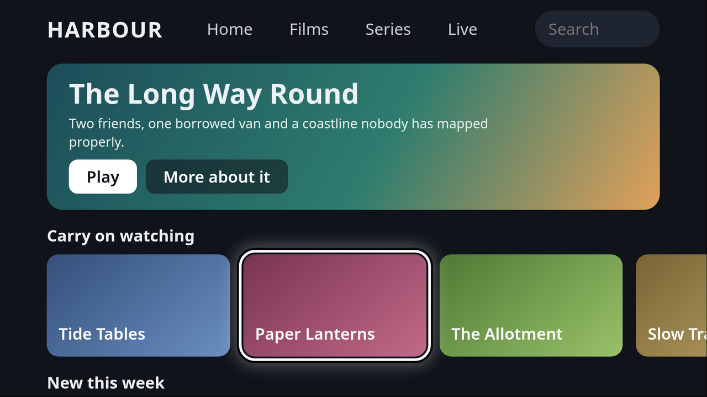
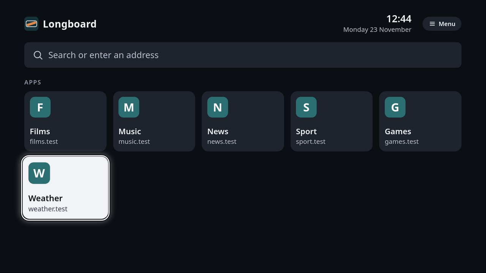
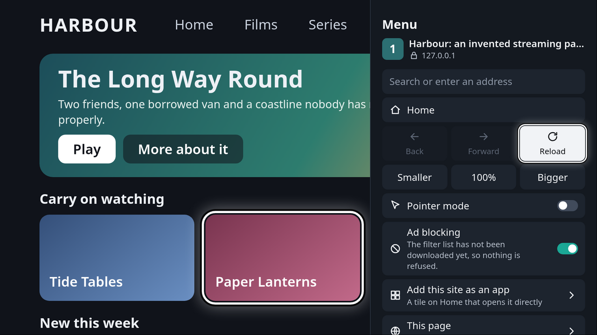
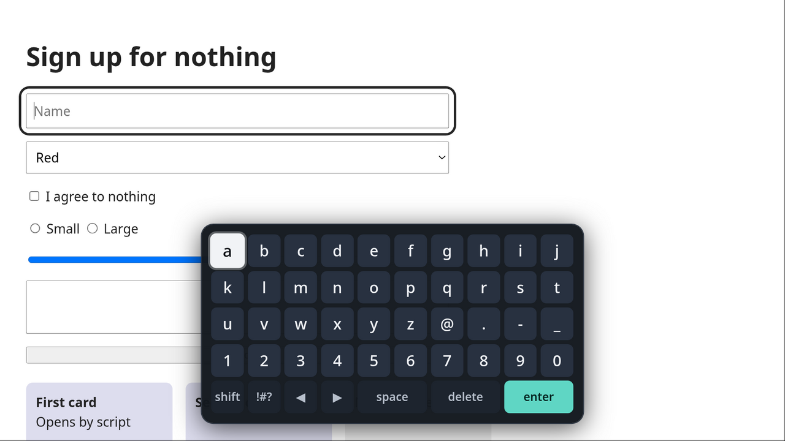

<div align="center">


# Longboard

**A web browser for the TV.** Drive any website from the couch with a remote,
a game controller or a keyboard.

[Download](#install) · [Website](https://andrewgbest.github.io/Longboard/) · [What works](#what-works) · [Release notes](docs/RELEASE-NOTES.md) · [Report a problem](https://github.com/AndrewGBest/Longboard/issues/new/choose)

[](https://github.com/AndrewGBest/Longboard/releases/latest)
[](https://github.com/AndrewGBest/Longboard/actions/workflows/ci.yml)
[](LICENSE)
[](https://scorecard.dev/viewer/?uri=github.com/AndrewGBest/Longboard)



<sub>The page in the pictures is invented for this project. Longboard shows real websites; their pictures are not ours to print.</sub>

</div>

## What it is

Websites are built for a mouse or a finger. Longboard makes them work with
six buttons: up, down, left, right, OK and Back. It finds the things you can
press on a page and moves a highlight between them. There is nothing to set
up per site.

- **Any website.** News, search, shops, video, music, web apps. Not a list
  of supported services: a whole browser, built on Chromium.
- **Streaming services play.** Protected video plays through the browser's
  standard component (Widevine), as it does in other browsers.
- **An on-screen keyboard** comes up when you press OK on a text field, and
  you can also type from your phone or speak.
- **Any site can be an app.** Add a site to Home and to your TV's app list
  and it opens like one, with a full-screen loading screen in between.
- **A pointer when you need one.** One button gives you an on-screen cursor
  for the rare page the highlight cannot handle.
- **Profiles for the finishing touches.** A profile is a small settings
  file for one website: where the highlight starts, or that the site has an
  interface or a layout made for TVs, which Longboard then asks for. Profiles are
  data, not programs; anyone can
  [write one](https://github.com/AndrewGBest/Longboard-Profiles).
- **Ad blocking you control**, per site, and **no telemetry** at all.

**What it is not:** it is not a media centre, it holds no content and it
unlocks nothing. You need your own accounts, and each site decides what it
shows you.

**How far along it is:** early, released and in daily use on its owner's TV.
It is tested by scripts against invented pages and a list of 68 well-known
sites, and by its owner with a remote. Nobody else has reported on it yet:
expect rough edges, and please [say what you find](https://github.com/AndrewGBest/Longboard/issues/new/choose).

<table>
<tr>
<td></td>
<td></td>
<td></td>
</tr>
<tr>
<td align="center"><sub>Home</sub></td>
<td align="center"><sub>The menu</sub></td>
<td align="center"><sub>The on-screen keyboard</sub></td>
</tr>
</table>

## Install

Linux with a desktop session, on a 64-bit Intel/AMD or ARM machine. These
links always point at the newest release.

| | Intel / AMD | ARM |
|---|---|---|
| **AppImage** (updates itself) | [Longboard-x86_64.AppImage](https://github.com/AndrewGBest/Longboard/releases/latest/download/Longboard-x86_64.AppImage) | [Longboard-arm64.AppImage](https://github.com/AndrewGBest/Longboard/releases/latest/download/Longboard-arm64.AppImage) |
| **Flatpak** file | [Longboard-x86_64.flatpak](https://github.com/AndrewGBest/Longboard/releases/latest/download/Longboard-x86_64.flatpak) | [Longboard-aarch64.flatpak](https://github.com/AndrewGBest/Longboard/releases/latest/download/Longboard-aarch64.flatpak) |
| **tar.gz** | [Longboard-x64.tar.gz](https://github.com/AndrewGBest/Longboard/releases/latest/download/Longboard-x64.tar.gz) | [Longboard-arm64.tar.gz](https://github.com/AndrewGBest/Longboard/releases/latest/download/Longboard-arm64.tar.gz) |

**AppImage:** download it, make it runnable, run it.

```
chmod +x Longboard-x86_64.AppImage
./Longboard-x86_64.AppImage
```

**Flatpak:** `flatpak install --user ./Longboard-x86_64.flatpak`, then
`flatpak run` it or pick it from your app list. It is a file, not on Flathub,
so it does not update itself.

Each file's SHA-256 digest is on the
[release page](https://github.com/AndrewGBest/Longboard/releases/latest).
From 0.3.28 a release also says, verifiably, that it was built by this
repository's workflow: `gh attestation verify <file> -R AndrewGBest/Longboard`.
The ARM packages are built and tested by script on ARM machines and have not
yet been tried on an ARM TV box.

## Buttons

| Button | Does |
|---|---|
| Arrows, D-pad | Move the highlight; scroll when there is nothing to move to |
| OK, Enter, A | Select. On a text field: the on-screen keyboard |
| Back, Backspace, Escape, B | Back; Home from a site's first page |
| Menu key, Start, Ctrl+O; or Up twice at the top of a page | The menu: address, Home, Back, Forward, Reload, zoom, pointer, ad blocking for this site, Speak, Type from a phone, tabs, history, Settings |
| "Pointer mode" in the menu, F2, pressing the right stick | The on-screen pointer, on and off |
| A remote's Home button | Home |
| Ctrl+Q | Quit |

While a video plays, OK pauses and plays, left and right seek, and up and
down bring up the player's own controls. Keys and controller buttons can be
remapped in Settings or in `~/.config/Longboard/config.json`.

## What works

Any site should be usable; these are the ones somebody has actually sat
through. "Tested" means by the owner or by script on the date in
[docs/STATUS.md](docs/STATUS.md), which has the detail and the rough spots.
Names are used only to say what was tested; see the notice at the foot.

| Site | State | Notes |
|---|---|---|
| YouTube | Works, in its TV interface | Longboard opens the interface the site makes for TVs, with previews |
| Netflix | Works | Browsing, search, playback and the progress bar |
| Prime Video | Works | With a reviewed profile |
| Disney+ | Works | |
| Apple TV | Works | |
| Spotify | Works | With a reviewed profile |
| Sportsnet+, TSN | Work | Live channels play; the player sits in a long page and is reached with the arrows |
| Players embedded from another site | Work | OK on the player takes it full screen, where the remote drives it |
| Rogers Xfinity Stream | **Does not play** | The service refuses playback on Linux in any browser we tried ([issue 1](https://github.com/AndrewGBest/Longboard/issues/1)) |
| The 50 most-visited websites | Navigable | The highlight gets around each, signed out; see [docs/SCORECARD.md](docs/SCORECARD.md) |

> [!NOTE]
> Picture quality is the service's decision. Several services send a browser
> on Linux a smaller picture than they send a TV app, because of how
> protected playback works there. Longboard does not, and will not, work
> around that.

## What is missing

Compared with a mainstream browser, today:

- **No Safe Browsing.** Nothing warns about known phishing or malware sites.
- No sync between machines and no translation.
- Passwords are kept only on a system with a keyring, and only filled in
  when asked; there is no other autofill. Speech is English only.
- Extensions from the Chrome Web Store can be added, but not all work, and
  those that block by rule lists (uBlock Origin Lite) block nothing.
- Ad blocking refuses requests that a public filter list names. It does not
  hide the gaps ads leave and does nothing about adverts inside a video.
- USB, serial and screen capture are refused to every site.
- Linux only. An Android TV version is researched, not built.

## What it will not do

- **Remove or work around DRM**, download streams, skip adverts inside a
  video, or get round a paywall or a region limit.
- **Send telemetry.** No analytics, no crash upload. What it fetches by
  itself in the background is listed in Settings and can be turned off.
- **Pretend to be something it is not, except where that is measured to
  help.** Longboard tells sites what it is: the engine it is built on, and
  its own name. The two exceptions today: a site with an interface made
  for TVs is told the engine TV apps run on, with Longboard as the device,
  because that is what makes the site serve its TV interface; and a site
  with a larger layout for browsers on TVs is told, after everything
  Longboard always says, that it is on one. It never
  claims to be another maker's device, and never does this to get past DRM,
  a paywall or a region limit.

The reasons are in [docs/LEGAL-GUARDRAILS.md](docs/LEGAL-GUARDRAILS.md).

## Build it yourself

Node 22 or newer, on Linux:

```
git clone https://github.com/AndrewGBest/Longboard
cd Longboard
npm install
npm start          # in a window; add an address to open it
npm run tv         # full screen, as on a TV
```

[CONTRIBUTING.md](CONTRIBUTING.md) says how to help: report a site, write a
profile (no programming needed), or change the code. Questions go to
[Discussions](https://github.com/AndrewGBest/Longboard/discussions);
[SUPPORT.md](SUPPORT.md) says what goes where.

## Documents

| Document | What it covers |
|---|---|
| [docs/DESIGN.md](docs/DESIGN.md) | What Longboard is, who it is for, how it behaves |
| [docs/ARCHITECTURE.md](docs/ARCHITECTURE.md) | How it is built |
| [docs/PROFILES.md](docs/PROFILES.md) | The profile format, the catalogue, import and export |
| [docs/LEGAL-GUARDRAILS.md](docs/LEGAL-GUARDRAILS.md) | The rules and why they exist |
| [docs/STATUS.md](docs/STATUS.md) | What exists and what has been checked, newest first |
| [docs/DECISIONS.md](docs/DECISIONS.md) | Choices made, with dates and reasons |
| [docs/RELEASE-NOTES.md](docs/RELEASE-NOTES.md) | What changed in each release |
| [docs/ROADMAP.md](docs/ROADMAP.md) | Order of work |
| [docs/SCORECARD.md](docs/SCORECARD.md) | How it did on a fixed list of public sites |
| Research: [browsers](docs/RESEARCH-BROWSERS.md), [store and ARM](docs/RESEARCH-STORE-ARM.md), [Android](docs/RESEARCH-ANDROID.md), [voice](docs/RESEARCH-VOICE.md) | What others do and what was found, with sources |
| [SECURITY.md](SECURITY.md) | How to report a security problem |
| [CODE_OF_CONDUCT.md](CODE_OF_CONDUCT.md) | How people here treat each other |
| [CLAUDE.md](CLAUDE.md) | Working rules for every contributor, human or AI |

## How it is made

The code is written with Claude Code, an AI coding agent, directed and tested
by the owner, who is responsible for what is released. It grew out of
[Tropic Video](https://github.com/AndrewGBest/Tropic-Video), which does this
for one website.

## Licence

GPL-3.0 for the application. Profiles in the shared catalogue are data and are
CC0-1.0, free for anyone to reuse.

Ad blocking uses the request matcher from Ghostery's adblocker library
(MPL-2.0, https://github.com/ghostery/adblocker), which is built into the
program, and the EasyList filter list (https://easylist.to, by the EasyList
authors, GPL-3.0 or CC BY-SA 3.0), which is not part of Longboard: each
copy of Longboard downloads it from its authors.

Longboard is an independent project. It is not affiliated with any website or
streaming service it can display. It does not provide, unlock or bypass access
to any content and does not remove or work around DRM.

The names of websites and services above are used only to say what was
tested. They belong to their owners, who have not endorsed Longboard.
